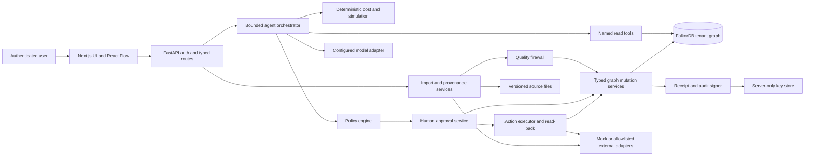
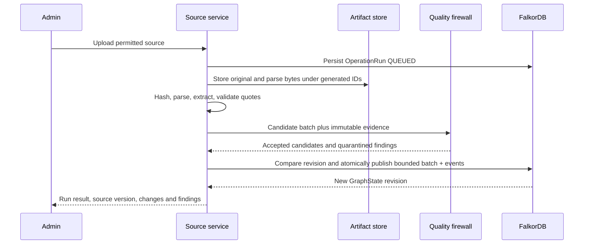
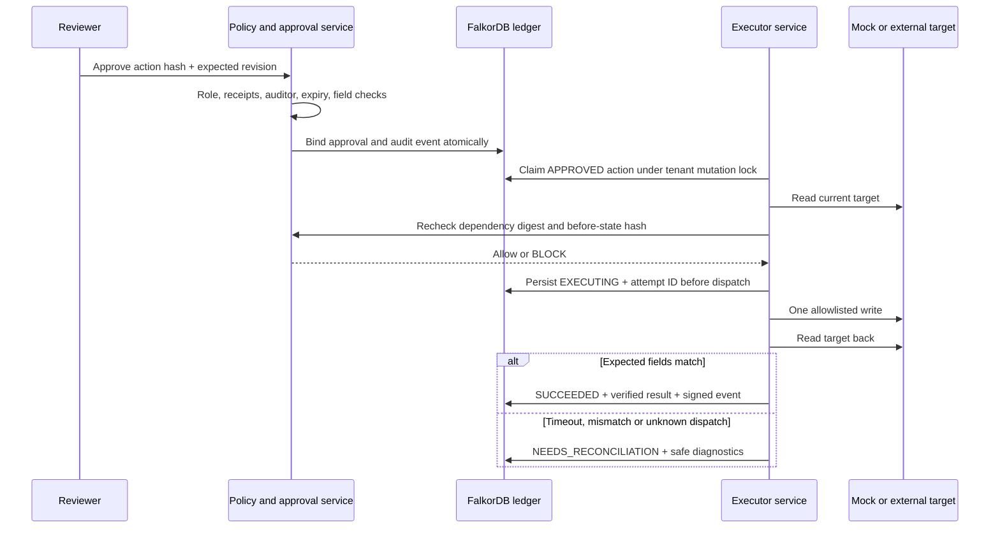

# Architecture and recovery

Status: proposed architecture; nothing deployed. Baseline §3 preserved, elaborations D03/D09/D12. Detailed contracts: [schema](FALKORDB_SCHEMA.md), [API](API_CONTRACTS.md), [agents](AGENT_DESIGN.md).

## 1. Components and topology

Single local backend process owns a serialized mutation queue per tenant; one logical graph writer service is mandatory. UI calls backend through same-origin proxy. Only backend accesses FalkorDB, source volumes, connector credentials or signing keys. Demo graph `company_demo` is selected through authenticated server configuration. Source files are artifacts, not an additional database. OperationRun, proposals, audit and traces live in FalkorDB. No Redis queue, SQL store, search service or agent-framework state store is added.

Future local topology: three services (frontend, backend, FalkorDB), private network, durable graph/source volumes, read-only secret mount, localhost browser access. FalkorDB Browser is optional developer tooling on loopback only. Production alternatives and gaps are in [deployment plan](CONFIGURATION_AND_DEPLOYMENT_PLAN.md).

## 2. Trust boundaries

| Boundary | Trusted control / untrusted input |
|---|---|
| Browser → API | Server session, role/tenant lookup and request validation / user IDs, revisions and parameters |
| Sources → parser/model | File type/size/encoding checks, evidence verification / document text and embedded instructions |
| Model → application | Strict DTO validator and deterministic policy / all model outputs, confidence, suggested IDs |
| Application → graph | Named templates and typed writes / no user-selected graph or query identifiers |
| Application → providers | Configured destinations and narrowly scoped credentials / remote response shape, links and availability |
| Signer → receipt consumers | Trusted configured public-key registry / envelope, key ID and verification claims |
| Administrator → storage | Operational controls / a compromised admin can rewrite graph/files; external checkpoint is needed for stronger rollback detection |

## 3. Ingestion and publication

Before publication, verify source ACL, ontology, evidence, uniqueness keys and expected source predecessor. A publication activates source version, chunks, facts, receipt versions and audit events together. The future S01 spike must prove all-or-nothing writes and conditional revision checks using the selected engine. No multi-statement atomicity is assumed. MVP should use a single bounded mutation statement per publish; if it exceeds supported size, split into independently complete source units or leave the run unpublished. Staged candidate payloads in OperationRun are not queryable business facts.

Artifacts are stored before graph commit. On crash they may be unreferenced; recovery checks hashes and the run manifest before reuse. Garbage collection requires retention grace and a reference audit. A committed SourceVersion whose artifact is missing creates a critical finding; dependent execution fails. The graph/file pair is not a distributed transaction.

## 4. Question and agent flow

Orchestrator captures GraphState revision and accessible input IDs, executes approved read templates, and checks revision again before sealing a result. If changed, retry the read assembly once; otherwise return STALE_SNAPSHOT. Scenario calculation is a pure function of captured inputs, policy/calendar/formula versions and explicit overlay. Its write is only a Scenario/OperationRun result, never an assignment to a live issue.

Compiler runs during ingestion. Interactive order: Graph Investigator → deterministic Margin Investigator → Planner → independent Auditor → Policy Engine → proposal. Results reference the same request, tenant, graph revision and evidence versions. Max five graph tool calls is global per normal question, not five per agent. A planner revision can reuse validated evidence; further retrieval exceeding the budget requires a new request.

Durable OperationRun stores phase, status, input digest, safe output, elapsed/token metadata and cancellation. AuditEvent stores backend-generated tool steps with `step_id`, template, safe parameter summary, row count and returned IDs; raw chain-of-thought is not stored. Only validated outputs become business state. A cancelled run cannot dispatch a write; cancellation after dispatch means reconcile, not assume rollback.

## 5. Approval and execution sequence

Authorization and atomic claim prevent two local executors from dispatching the same action. External mutation and graph commit are not atomic. Keep one-target MVP actions; never hide partial success. The backend may perform a connector GET outside the mutation lock, then reacquire it to compare graph dependencies and claim immediately before dispatch. External atomic preconditions are used only if verified supported. Without target compare-and-set, concurrent external edits remain a documented residual risk; disable high-impact live writes until an acceptable provider-specific strategy exists.

## 6. Event, retry and crash recovery

| Failure point | Durable state | Recovery |
|---|---|---|
| Before source bytes stored | QUEUED/RUNNING run | Retry upload/read with same idempotency key |
| After artifact storage, before publish | Run plus artifact manifest | Verify bytes; resume validation; no active fact until publish |
| During atomic graph publication | Pre- or post-commit graph, as proven by S01 | Read run/idempotency record; never assume failure means no commit |
| Model timeout/invalid output | Failed phase, prior deterministic findings | One schema-repair attempt; bounded provider read retry; fail closed for actions |
| After approval, before dispatch | APPROVED | Repeat freshness/before-state check; claim once |
| After dispatch, before response/audit | EXECUTING with attempt ID | Restart moves to NEEDS_RECONCILIATION; GET target; no automatic re-send |
| Read-back mismatch or partial write | NEEDS_RECONCILIATION | Report expected/actual diff; human review; compensating proposal needs new approval |
| Graph unavailable after external success | Durable pre-dispatch attempt, no final result | Stop further writes; recover graph, reconcile actual target, append observed result |
| Source or key changed | Stale dependency or revoked key finding | Invalidate affected approvals; verify historical versus current trust separately |

Read retries: up to 3 attempts, exponential delay with jitter and Retry-After when supplied, max 30 seconds total; 401/403/schema errors do not retry automatically. Provider model inference may retry once on transient failure subject to budget. No blindly retried non-idempotent write. Failure recovery belongs to typed services, not an autonomous agent improvising tools.

## 7. Graph paths and projections

Read repository resolves entities and executes Q01–Q10 from the schema document. Responses contain stored IDs, relation types, evidence IDs, query template ID and graph revision. Node display layout is client-owned, relationship truth is server-owned. Derived reverse paths retain the underlying stored direction. Scenario edges have separate IDs prefixed `scenario:` in response DTOs and are never presented as stored active edges.

Promise.current_state/current_version_id, source.current_version_id and counters are rebuildable projections. Their values are checked against event/version chains during verification. GraphState revision increments on every business/evidence/policy mutation, not on ordinary traces or read-only results. Dependency digest binds the subset a proposal relies on; unrelated graph changes trigger revalidation but need not invalidate a still-identical dependency set.

## 8. Capacity and production boundary

MVP serializes writes intentionally to simplify receipt sequence, unique IDs and action dispatch. Reads remain bounded and concurrent. No claim of horizontal scalability, exactly-once external delivery, tenant graph ACL enforcement by the database, or transaction isolation is made until tested. Production requires durable worker leases, failover fencing, stronger key custody, backups/checkpoints outside the graph, proper identity federation and measured capacity. These are phase P6, not hidden MVP dependencies.
