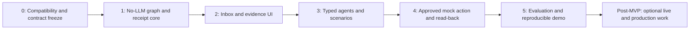

# Future implementation plan

**Plan only. Do not execute in this documentation task.** The current output is Markdown; no application scaffolding, dependency installation, source generation or deployment is authorized by this file. Baseline §16 order retained: 0 compatibility → 1 no-LLM core → 2 minimal UI → 3 bounded agents → 4 closed-loop action → 5 evaluation/demo.

## Implementation checklist

These four steps are the required implementation sequence. They consolidate the detailed phases below; all remain **NOT STARTED**. Completing this documentation does not complete any implementation step.

- [ ] **1. Review the decision log and complete phase-0 compatibility spikes.** Review D01–D18 and Q01–Q09 in [DECISIONS_AND_OPEN_QUESTIONS](DECISIONS_AND_OPEN_QUESTIONS.md), preserve the original inputs, and perform the applicable phase-0 work in §2. Prove the selected FalkorDB/client pair, atomic publication, query/index behavior and receipt canonicalization/signing; record actual versions, image digests and results. Complete the applicable S03/S09 package checks and record optional connector prerequisites as OPEN when unavailable. Exit gate: M0 and its T07/T11/T25/T26 subset. S08's full-seed measurements remain a phase-5 gate; missing live credentials do not block the fixture build.
- [ ] **2. Freeze contracts and implement the no-LLM graph/receipt core.** Freeze [API_CONTRACTS](API_CONTRACTS.md), [FALKORDB_SCHEMA](FALKORDB_SCHEMA.md), [PROMISESEAL_PROTOCOL](PROMISESEAL_PROTOCOL.md) and [SEED_SCENARIO](SEED_SCENARIO.md) before implementing phase 1 (§3). Build ingestion, exact evidence validation, controlled graph writes/queries, source and receipt versions, signatures, audit, deterministic calculations and tenant/role enforcement. Exit gate: M1, including real graph paths, idempotent imports, rejected unsupported facts, valid/invalid receipt checks and two-tenant isolation, all without LLM calls.
- [ ] **3. Add the UI, bounded agents, and approved mock action.** Complete phases 2–4 (§§4–6) in order. Connect the UI to actual graph/evidence responses; add typed extraction, investigation, deterministic simulation and independent audit; then implement proposal → human approval → mock execution → read-back → audit. Exit gates: M2–M4, including bounded tools/revisions, no scenario mutation of live facts, zero writes before approval, stale-approval blocking, one verified mock action and safe uncertain-write reconciliation.
- [ ] **4. Run the real-FalkorDB tests and reproducible demo before enabling live integrations.** Complete phase 5 (§7), [TEST_AND_EVALUATION_PLAN](TEST_AND_EVALUATION_PLAN.md) and [DEMO_SCRIPT](DEMO_SCRIPT.md). Run the applicable suite against the pinned real database, frontend checks and benchmark cases; reproduce the credential-free demo twice and record actual results and limitations. Exit gate: M5 and all mandatory safety checks. Only then activate an optional live connector that also passes its own S04/S05/S06 contract, credential, consent and permission gates. The real workload API stays disabled until its actual contract is supplied and verified.

Live activation gate: connector code and explicitly authorized isolated sandbox compatibility checks may be prepared earlier, but live integrations remain disabled in the application until step 4 passes. Passing the mock workflow never establishes live-provider compatibility. No implementation, sandbox calls or live activation is performed in this documentation-only task.

## 1. Priorities, dependencies and work split

P0 risk priorities: immutable evidence/receipt bytes, actual graph queries, typed ontology, tenant/role authorization, accurate arithmetic and no unapproved/duplicate writes. P1: connected UI, conflicts/freshness, scenarios and reproducible demo. P2: live connectors and visual polish after core passes. Do not start with a generic dashboard or connector proliferation.

Suggested later team split (not agents spawned in this phase): backend/graph owner handles schema/ingestion/templates; protocol/security owner handles signing/auth/policy/action ledger; UI owner handles typed evidence workflow/accessibility; integration/evaluation owner handles fixture oracles/adapters/benchmarks. One maintainer owns contract changes; any shared enum/DTO change updates all documents/models/tests together. With one developer, use the phase order and keep optional tasks out of the critical path.

## 2. Phase 0 — compatibility and freeze

Reinspect workspace, preserve current docs, inspect real runtime/Docker availability, and record actual repository changes separately. Create dependency/deployment files only in the later authorized build. Resolve the following spikes before relying on their behavior:

| Spike | Required work / evidence | Blocking scope / fallback |
|---|---|---|
| S01 FalkorDB | Select official image tag+digest and falkordb-py version; test binding, ro_query rejection, graph selection, indexes/constraints, multi-hop paths, parallel assertions, atomic conditional publication, concurrent claims, persistence/reset/cache and backup/restore | Mandatory before graph writes. If pair fails, test another supported FalkorDB pair; do not substitute mock/another DB |
| S02 Receipt | Test stable cryptography/runtime/wheel; implement golden canonical-byte vectors and sign/verify/negative cases; verify key registry/rotation assumptions | Mandatory for signed receipts; unsigned proposals cannot authorize execution |
| S03 App stack | Check official package manifests/licenses/peer ranges for baseline FastAPI/Pydantic/httpx and Next/React/TypeScript/Tailwind/React Flow; validate one typed DTO and client graph rendering/accessibility | Mandatory stack freeze; omit optional shadcn/ui if unnecessary |
| S04 Transcript | Verify current Vexa endpoint/auth/response/platform/error contract or Graph tenant permissions/meeting/speaker settings; capture authorized synthetic/sandbox fixtures | Optional live only; file provider mandatory |
| S05 Jira | Reopen official issue read/create/edit docs; verify selected site's identity/custom fields/status/dependency mapping and pagination; prove read-only sandbox, then one approved write/read-back only if in scope | Live boundary only; export import fallback |
| S06 Workload | Obtain Q01 real contract; define mapping/validation, auth, units, CAS/idempotency and sandbox/read-back tests | Live only; cannot proceed by guessing; mock remains complete |
| S07 Model | Select approved provider/model, structured-output support, privacy/budget and timeout/error behavior; verify official SDK/version if used | Generated analysis; deterministic/manual gold/replay path remains labelled |
| S08 Performance/recovery | Measure seed graph queries, serialized mutation behavior and artifact publication/restart; confirm proposed limits and demo restore procedure | Mandatory before demo readiness; scale down bounded work, not safety |
| S09 Supply chain | Record licenses/notices and dependency advisories for selected versions, including server/image and optional copied UI components | Before release of selected components; zero upstream source copied by default |

Milestone M0: version ledger with actual tested results, DTO/state/ontology freeze and crypto byte vectors. Gate T07/T11/T25/T26 appropriate subset. OPEN external credentials do not block M0 fixture decisions; unproven graph atomicity does.

## 3. Phase 1 — no-LLM core

Tasks: implement schema/ontology/index initialization; deterministic synthetic seed materialization from SEED_SCENARIO; typed GraphRepository and Q01–Q10; safe artifact storage/parsers/hashes/quotes; SourceRecord/Version idempotency; entity resolution and quarantine/conflict logic; receipt canonicalization/signatures/version/audit; basic local auth/tenant ACL; Decimal formulas; durable OperationRun and serialized writer/recovery. Use manually labelled candidate fixtures to validate graph pipeline before compiler model calls.

Acceptance M1: source evidence → proposed receipt → contract/task/capacity/milestone graph path works with no LLM. Duplicate import creates zero duplicate facts/receipts. Invalid quote/relation creates finding, no active semantic edge. Signed payload is retained/versioned, verification detects tampering. Two-tenant negative tests pass. Gate T01/T04/T07/T08/T11/T12/T13/T17/T22/T30 and S01/S02.

## 4. Phase 2 — minimal end-to-end UI

Tasks: shared typed API client, local session/mode banners, Promise Inbox/Detail, quote/contract/dependency panels, version/verification view, graph proof inspector after actual query results exist, loading/empty/unauthorized/offline/stale states. Accessible relationship table first if graph library setup needs investigation. Add Overview/Health/Settings as thin real-data views, no fabricated charts.

Acceptance M2: viewer navigates actual current promise/evidence/version path and sees PROPOSED distinctly; reviewer action creates new version with optimistic concurrency; graph uses backend IDs and provenance; mobile/keyboard equivalent. Gate T20/T21 plus relevant T08/T11/T17. UI polish cannot conceal missing backend gates.

## 5. Phase 3 — extraction, analysis and simulation

Tasks: validated Compiler with quote/entity review; bounded Graph Investigator/scope checking; deterministic Margin Investigator; pure scenario overlay/scheduler; three scenario families; independent Auditor; P01–P12 policy; persisted safe trace/run result; model outage fallback; new assumption creates new scenario; impact traversal and freshness invalidation.

Acceptance M3: main question yields evidence/qualified scope, five-hour gap, separated financial values, three scenarios and a challenge tied to real evidence. Initial conflict blocks action readiness. No scenario changes live business nodes. Missing rate/calendar/source stays UNKNOWN. Gate T02/T03/T04/T05/T06/T18/T27/T28/T30; extraction metrics are first measured here, not invented.

## 6. Phase 4 — one closed-loop action

Tasks: deterministic mock WorkloadAdapter and before/after ledger; scenario→proposal→request approval→approve→execute→read-back; reviewer/executor capability separation; immutable proposal hash/dependency digest; predispatch freshness/target check; uncertain-write reconciliation; receipt revocation/source retirement and dependent invalidation; Jira synthetic import and preparation of optional read-only sync after S05 compatibility checks. Keep live sync disabled until M5 passes. No real workload mapping without Q01.

Acceptance M4: preapproval execution yields zero writes; source edit/expiry blocks stale approval; distinct authorized approver/executor produce one mock reservation; matching read-back and signed audit event; restart after accepted write never blindly resends. Gate T09/T10/T16/T17/T19/T29 and all prior safety regression tests. Live Jira activation is not an M4 requirement; it remains gated on M5 and its own sandbox validation.

## 7. Phase 5 — evaluation, demo and handoff

Tasks: run real-FalkorDB full suite and frontend lint/typecheck/build; run B01–B24 and extraction labels; publish actual metrics/limitations; rehearse all demo scenes twice from deterministic reset; prepare clearly labelled fallback recording; verify backup/restore/secret scan; freeze selected versions and setup instructions. Establish M5 using the credential-free workflow before activating any optional live connector. Vexa/Graph additionally requires S04 and consent; Jira requires S05 and configured permissions; real workload requires Q01 and S06. Optional graph-versus-document baseline only after mandatory gates pass.

Acceptance M5: every required traceability row has actual evidence; hard deterministic gates all pass; path/extraction scores and failures reported; five-minute workflow reproducible without third-party credentials; benchmark report contains real results and no upstream borrowed score. Gate T01–T31 applicable scope plus documentation consistency T32. If threshold missed, report it and remediate mandatory behavior; do not fabricate pass or hide failed cases.

## 8. Hackathon allocation and scope cuts

Suggested four-day allocation, **planning estimate only**: day 0/early day1 P0+P1; remainder day1/day2 P2; day2/day3 P3; day3/day4 P4 and P5. If crypto/graph/action safety requires longer, reduce optional breadth. Serial dependencies cannot be bypassed by calendar optimism.

Cut first: optional live providers, full self-host Vexa, SDK experiments, vector/full-text extras, PDF/DOCX, additional graph algorithms, multi-tenant UI, live Jira writes, visual polish and baseline-comparison experiment. Preserve all mandatory product screens as minimal working views, actual graph paths, provenance/crypto/policy, one mock action and required test evidence. Do not label a partial prototype a complete MVP if mandatory acceptance fails. Narrow dataset/throughput instead of weakening safety.

## 9. Definition of done for the later MVP

- Pinned three-service startup and seed/reset/replay commands exist and are actually tested; exact commands/results documented then.
- Demo/mock modes visible; file import, idempotency, quality findings, conflicts and source history work.
- Proposed commitment requires authorized review; valid receipt verifies; payload/key/signature/chain mutation fails; new versions preserve old history.
- Actual FalkorDB queries join promise, contract, issues/dependencies, workload/rates and acceptance/milestones; UI displays backend path/evidence.
- Deterministic scenarios/math pass independent fixtures and never mutate live nodes; Auditor/policy block unsupported actions.
- No external write before bound valid approval; one approved mock reservation read-back verifies; uncertain writes reconcile safely.
- Tenant/ACL/prompt-injection/secret/privacy tests pass; live connector failure does not break fixture path.
- Actual benchmark/test/accessibility/demo evidence exists and limitations/production gaps are reported; no claim of VC/legal/immutability guarantees.

## 10. Post-hackathon / production sequence

P6a: owner-approved live contract mappings, real identity/permission model, provider consent/data processing and sandbox action tests. P6b: audited retention/deletion/backups, protected keys/checkpoints, monitoring/incident ownership and licensing review. P6c: proven durable worker leases/fencing, concurrency, availability/load/restore targets. P6d: larger annotated evaluation, optional schema-constrained SDK/vector experiments in isolated graph, PDF/DOCX and possible JCS/VC interoperability project with explicit conformance tests. None is implicitly authorized by this documentation task.
